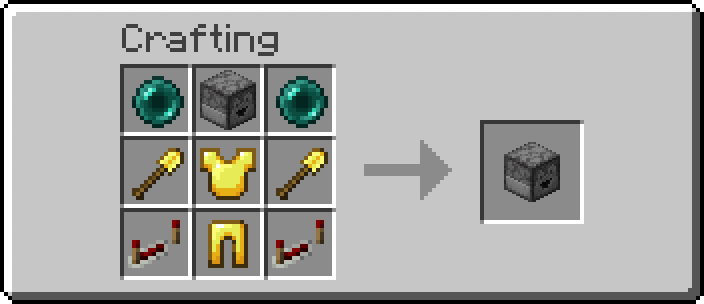

# Livestock Feeder

[README 日本語](README.md)


A data pack that adds an automatic feeding machine for your farm animals.

Just **place a crafted "Livestock Feeder"** and load it with the right feed. That's it.
No redstone and no other power source required.

The data pack only needs to be installed on the server. **Clients can join with an unmodified vanilla game.**

---

## Requirements

| Item | Value |
|---|---|
| Minecraft Java Edition | 26.1 to 26.2 (mainly tested on 26.1.2) |
| Data pack format | `min_format: 101` / `max_format: 107` |
| Install location | Server only (nothing to install on the client) |

This is not a mod, so no client-side installation is needed. It does not use a resource pack either.

## Supported animals and feed

| Animal | Feed |
|---|---|
| Cow | Wheat |
| Mooshroom | Wheat |
| Sheep | Wheat |
| Pig | Carrot / Potato / Beetroot |
| Rabbit | Carrot / Golden Carrot / Dandelion |
| Chicken | Seeds (wheat, beetroot, melon, pumpkin, and so on) |

Nether animals such as Hoglins are not supported, and there are no plans to add them.

---

## Installation

Put the `livestock_feeder` folder into `<world>/datapacks/`. For an existing world, run `/reload` afterwards.

For a new world, install and enable the data pack from the world creation screen, then start playing as usual.

```
<world>/datapacks/livestock_feeder/
├── pack.mcmeta
├── pack.png
└── data/
```

If you would rather install it as a zip, make sure **`pack.mcmeta` sits at the root of the archive**.

Zipping the repository folder itself puts everything one level deeper, and Minecraft will not load it.

```sh
cd livestock_feeder && zip -r ../livestock_feeder.zip . -x '.git/*' -x 'datapack.config.json'
```

---

## How to use

### 1. Craft it



- Ender Pearl × 2
- Dropper × 1
- Golden Shovel × 2
- Golden Chestplate × 1
- Golden Leggings × 1
- Repeater × 2

The recipe unlocks in your recipe book once you are **holding both an Ender Pearl and a Dropper**.

### 2. Place it

Place the Livestock Feeder like any other block.

If you hear a beacon activating and see green particles, it registered correctly.

### 3. Load it with feed

Right-click the Livestock Feeder to open it, then put in the feed for whichever animals you want to raise.

While it has feed inside, it automatically feeds animals within 4 blocks.
**Green particles rise from a Livestock Feeder that still has feed**, so you can see at a glance whether it needs a refill.

You can mix several kinds of feed in the same Livestock Feeder. Each animal gets the feed it needs.
You can also pipe feed in with a hopper, exactly like a normal dropper.

### 4. Remove it

Break the Livestock Feeder like any other block.

It drops as an item, so you can pick it up and place it somewhere else.

Because of how the internals work, green particles may linger for up to 30 seconds afterwards.

---

## How it behaves

A Livestock Feeder runs one cycle every 30 seconds. For each kind of animal, it checks the following in order.

1. **Is there feed for this animal?** — if not, move on to the next animal immediately
2. **Speed up a nearby baby's growth** — this does not add animals, so it ignores the density limits
3. **Check the density limits**
4. **Breed, if two adults are nearby**

These checks run **independently for each kind of animal**. While one species is busy raising a baby, **the others keep breeding normally** — and so does that same species, as long as it is under its density limit.

Density limits exist to keep breeding from running away.
I built the Livestock Feeder with small and mid-sized country farms in mind.
Picture coming home after a day's work and noticing, "ah, there are a few more than yesterday." That small pleasure is what this is for.

If you need an industrial-scale meat factory, you will be happier with a mod built for that.

### About growth

It shortens a baby's remaining growth time by 10%, the same as vanilla. (One baby per cycle.)

That limit is **per species**, so if a baby cow and a baby pig are both nearby, both get fed in the same cycle.

Each feeding consumes one item of feed from the Livestock Feeder.

Babies with **less than 2 minutes of growth left are skipped**. The 10% reduction gets exponentially less useful as a baby approaches adulthood, so leaving the last stretch to nature spends your feed far more effectively.

Babies locked with a **Golden Dandelion (`AgeLocked`) are also skipped**.
If a player has deliberately said "I want this one to stay a baby," that decision outranks growth.

### About breeding

When two or more adults are ready to breed, the nearest two are put into love mode. (One pair per cycle.)

Each breeding consumes two items of feed from the Livestock Feeder.

Unlike hand-feeding in vanilla, `LoveCause` is left undefined, so **breeding advancements and statistics do not count these pairings**.

Experience orbs drop just like in vanilla, so you can collect them if you happen to be nearby.

---

## Tuning

These are the values you are most likely to want to change.

| What | Default | Where |
|---|---|---|
| Cycle interval | 30 seconds | `function/load.mcfunction` **and** `function/tick.mcfunction` |
| Particle interval | 2 seconds | `function/load.mcfunction` **and** `function/glow.mcfunction` |
| Feeding range | Radius 4 blocks (sphere) | `distance=..4` in `function/species.mcfunction` |
| Per-species density limit | 8 | `cap` in the dispatch table in `function/table.mcfunction` |
| Overall density limit | 24 | `#total ... matches 24..` in `function/species.mcfunction` |
| Growth cutoff | 2400 ticks | `matches -2400..` in `function/grow_one.mcfunction` |

Note that both intervals live in **two places**.
Changing only `function/load.mcfunction` changes nothing but the very first delay.

### Notes on feed consumption

The single biggest factor in total feed consumption is the **cycle interval**. Even with the one-baby-per-cycle limit, a Livestock Feeder keeps spending one item every cycle for as long as there is a baby to feed.

In an early prototype with a 5-second interval, **over 90% of all feed went into growth**.
A full stack of 64 bought only four or five new animals, which is not worth the trouble of farming the feed.
The release default of 30 seconds exists to push that ratio back toward breeding.

That ratio shifts a lot with the state of your farm, though — how many babies there are, how close you are to the density limits, and which feeds you loaded.
**To see the real breakdown for your own farm, read the counters with `/function feeder:debug`.**

| What you want to know | Where to look |
|---|---|
| Where the feed is going | `grow` and `breed` on the `total` line (consumption is `grow` + `breed` × 2) |
| Whether it is idling on an empty feeder | `empty` / `visits` |
| What is blocking it | The `blocked` line and `<species>.cap` |

If feed still runs out faster than your herd grows, the first thing to try is **raising the growth cutoff**.
Babies reach adulthood on their own in 20 minutes, so if you are working nearby anyway, most of your feed ends up going into breeding instead of growth.

The second thing to try is **adjusting the cycle interval**.
A shorter interval does mean more breeding attempts, but growth runs in the same cycles.
Spending more cycles on growth does very little to increase your herd.

---

## Adding another animal

1. Create a feed item tag at `data/feeder/tags/item/<animal>_food.json`
2. Add that tag to `data/feeder/tags/item/all_food.json`
3. Add the animal's entity ID to `data/feeder/tags/entity_type/livestock.json`
4. Add one line to the dispatch table in `data/feeder/function/table.mcfunction` (a Goat, for example)

```mcfunction
$function feeder:$(op) {key:"goat", id:"minecraft:goat", food:"#feeder:goat_food", cap:"8"}
```

`key` becomes the prefix for that animal's statistics counters.
The same table drives feeding, statistics setup, display and reset, so **adding one line here adds the counters too**.

> **Careful: one line per animal, not per feed**
>
> If you lump together the wheat eaters — Cow, Mooshroom and Sheep — the nearest two might turn out to be a cow and a sheep.
> They cannot breed with each other, so the feed is consumed and nothing happens.

---

## Checking that it works

```
/function feeder:debug
```

This prints the number of markers, how many Livestock Feeders currently hold feed, and the running counters. It also emits a flame particle at every marker and prints their coordinates to chat.

Markers have no hitbox, so **F3+B will not show them**. Reading the coordinates is more reliable than looking for them.

There are 30 counters, which will not fit on the sidebar, so use this function instead.

Counters are **summed across every Livestock Feeder**. There is no per-machine breakdown.

| Counter | Meaning |
|---|---|
| `cycles` | Number of loop iterations. Just a clock (one per 30 seconds) |
| `visits` | How many times a Livestock Feeder has been visited. **Use this as your denominator** |
| `empty` | Times a Livestock Feeder held no feed at all |
| `<species>.slots` | Times that animal's feed was present |
| `<species>.grow` | Growth feedings (1 feed each) |
| `<species>.breed` | Breedings (2 feed each, and one new animal each) |
| `<species>.cap` | Times it stopped at that animal's density limit |
| `cap_all` | Times it stopped at the overall density limit |
| `low_food` | Times there was less than 2 feed to breed with |
| `no_pair` | Times fewer than 2 adults were ready to breed |

You can reset the statistics at any time. Run this between tuning experiments.

```
/function feeder:reset_stats
```

| Formula | Meaning |
|---|---|
| `cycles` × 30 seconds | Elapsed time. **Counts up regardless of feed or machine count** |
| Σ`grow` + Σ`breed` × 2 | Total feed consumed (1 per growth, 2 per breeding) |
| Σ`breed` | Animals born |
| Σ`breed` / `visits` | Average births per machine per cycle |
| `empty` / `visits` | Share of visits wasted on an empty machine |

### Use `visits` as the denominator

`cycles` counts up no matter how many machines you have or whether any of them hold feed, which makes it a poor denominator.
`cycles × machines` is not much better, since a Livestock Feeder in an unloaded chunk is never visited at all.

The totals appear on the `total` and `blocked` lines of `/function feeder:debug`, so you do not have to add them up yourself.

### Reading "why it did nothing"

What actually helps with tuning is not how often it worked, but **why it came up empty**.

| Counter that stands out | What to do |
|---|---|
| `empty` | Add feed, or you have too many machines for the size of the farm. |
| `<species>.cap` | That animal is saturated. Revisit `cap`, lengthen the interval, or cull more often. |
| `cap_all` | You are pinned at the overall limit of 24. Cull more often, or give the animals more room. |
| `low_food` | Refills are not keeping up. |
| `no_pair` | Not enough adults, or they are still on cooldown. **This is normal — it resolves on its own.** |

`low_food` and `no_pair` look alike but call for **opposite responses**.
The first needs a refill; the second needs nothing at all.

When `no_pair` dominates, the Livestock Feeder is talking to a herd that simply is not ready yet, so **lengthening the interval barely costs you any births**.
When `<species>.cap` dominates you are pinned at the limit, so lengthening the interval saves feed for free there as well.

### Cross-check

Every visit that found feed ends in exactly one outcome, so this identity holds:

```
Σ<species>.slots = Σ<species>.cap + cap_all + low_food + no_pair + Σ<species>.breed
```

If it does not balance, there is a path you have not accounted for.

### Manual registration (fallback)

A rescue function for when automatic registration fails. Stand on top of the Livestock Feeder and run:

```
/function feeder:register
```

---

## Known limitations

- **Selectors only search the current dimension.** Scheduled functions run in the Overworld context, so a Livestock Feeder placed in the Nether or the End is never visited.
- **It stops in unloaded chunks**, exactly like a hopper or a dropper. Nothing multiplies behind your back while you are away.
- **The overall population is counted once at the start of each cycle.** Animals born during that cycle are not counted until the next one.
- **When several babies of the same species are nearby, which one gets fed depends on entity iteration order**, not on distance. The same individual tends to keep being picked until it grows up — which in practice means they mature one at a time.
- **Breeding is not attributed to any player.** Because love mode is set through NBT, `LoveCause` stays empty and these pairings never count toward breeding advancements or the "Animals Bred" statistic. (Experience orbs still drop, just like vanilla.)

---

## Development notes

Pitfalls worth knowing about before you start modifying this. Every one of them cost me time in the field.

### The type of `CustomName` depends on how you named it

Since 1.21.5, text components are stored as NBT structures rather than JSON strings, which means **the NBT type changes depending on whether the name is styled**.

| How it was named | `CustomName` |
|---|---|
| Renamed in an anvil | `"Livestock Feeder"` (a plain string) |
| From the recipe (styled) | `{text:"Livestock Feeder",color:"yellow"}` (a compound) |

A string and a compound are different types, so neither matches the other.

**This project uses that as its key.** An anvil cannot add color to a name, so requiring a compound that contains `color` is what keeps anvil-made copies out and accepts only crafted ones.
If you change the name or the color, fix **both** `place/ray.mcfunction` and `register.mcfunction`.

Do not guess the format — check the real thing:

```
/data get block <x> <y> <z> CustomName
```

### Advancement rewards fire exactly once

`rewards` only runs at the moment the advancement is granted. **Once you have it, editing the JSON and running `/reload` does nothing at all.** You have to revoke it before every test.

```
/advancement revoke @s only feeder:recipes/feeder
```

For the same reason, `place/detect.mcfunction` **revokes itself on its first line**. Delete that and you will only ever be able to register one Livestock Feeder.

### There are two kinds of toast

| | Wording | Customizable? |
|---|---|---|
| Recipe Unlocked | "Check your recipe book" | Fixed translation key. No |
| Advancement Made | Determined by `frame` (task / goal / challenge) | The wording itself, no |

**Neither one shows the item's name.**
If you want the player to know what they just unlocked, sending a chat message from `rewards.function` is the reliable way (see `function/unlock.mcfunction`).

Also, **recipe toasts are merged into a single toast when several recipes unlock at the same moment**.
Unlock alongside a vanilla recipe and yours gets buried — with no item name shown, nobody will notice. (Gate it on a Dropper alone and it lands at the same instant as the Crafter.)

Requiring both an Ender Pearl and a Dropper is partly a way to dodge that collision.

### `as` and `at` are independent

Inside a function invoked with `execute as @e[...] run function ...`, **the execution position stays where the caller was** unless you re-position it with `at @s`.

The nasty part is that **anything touching NBT works correctly with `as` alone**. `grow_one.mcfunction` originally emitted its growth particles on top of the Livestock Feeder instead of on the baby, and nothing else looked wrong.

### `normal` and `force` particles swap roles by purpose

| Mode | Visible range | Client setting |
|---|---|---|
| `normal` | About 32 blocks | Culled when Particles is set to Decreased or Minimal |
| `force` | About 512 blocks | Always drawn, whatever the setting |

- **Use `force` for debug output.** Otherwise you cannot tell a server-side problem from a client setting
- **Use `normal` for anything always-on.** The server drops distant particles for you, which is exactly what you want here

I also tried emitting `angry_villager` every 2 seconds when a Livestock Feeder ran out of feed, but it was far too irritating to keep.
If you do want a clear out-of-feed signal, emitting it once per 30-second cycle from `each` is about right.

### You cannot see a marker

`minecraft:marker` has no hitbox, so **it does not show up under F3+B** either.
On top of that, the Livestock Feeder puts its marker at the center of the block, where the block itself hides it.
To confirm a marker is really there, print its coordinates instead of looking for it.

### Droppers cannot be dyed

Coloring in Minecraft depends on a `tintindex` in the model.
Only things with a defined area to tint — leather armor, potions, sheep wool — can be dyed.
The dropper model has no `tintindex`, so a `dyed_color` component does nothing at all.
(Beds and wool come in many colors not because they are dyed, but because **each color is a separate block**.)

Changing how a block like the Livestock Feeder looks takes a resource pack, or turning the project into a mod.
Distributing one through `resource-pack` in `server.properties` is possible, but it means building the pack, configuring the server, and having each client opt in to downloading it, so this project does not go there.

### When macros are worth it

Back when the only feed was wheat, writing it out line by line really was faster and easier to read than folding it into a macro.
Once six animals were supported, **that trade-off flipped**.
Duplicating the same block of code in six places means fixing six places every time, and you will miss one sooner or later.

Whether to spell it out or use a macro depends on the size of the code. "Avoid macros because they are slow" is not a rule.

---

## File layout

```
data/
├── feeder/
│   ├── advancement/
│   │   ├── placed_dropper.json      Placement trigger
│   │   └── recipes/
│   │       └── feeder.json          Recipe unlock condition
│   ├── function/
│   │   ├── load.mcfunction          Setup and loop startup
│   │   ├── tick.mcfunction          Main loop (30 s)
│   │   ├── glow.mcfunction          Particle loop (2 s)
│   │   ├── each.mcfunction          One machine's turn
│   │   ├── table.mcfunction         Animal list (macro, single source of truth)
│   │   ├── species.mcfunction       Feeding logic for one species (macro)
│   │   ├── grow_one.mcfunction      Growth
│   │   ├── breed.mcfunction         Breeding (macro)
│   │   ├── consume.mcfunction       Feed consumption (macro)
│   │   ├── unlock.mcfunction        Recipe unlock notice
│   │   ├── register.mcfunction      Manual registration (fallback)
│   │   ├── debug.mcfunction         Diagnostics
│   │   ├── reset_stats.mcfunction   Statistics reset
│   │   ├── stat/
│   │   │   ├── init.mcfunction      Create per-species counters
│   │   │   ├── reset.mcfunction     Zero per-species counters
│   │   │   ├── sum.mcfunction       Total per-species counters
│   │   │   └── show.mcfunction      Print per-species counters
│   │   └── place/
│   │       ├── detect.mcfunction    Entry point for the placement event
│   │       ├── ray.mcfunction       Raycast along the line of sight
│   │       └── hit.mcfunction       Place the marker
│   ├── item_modifier/
│   │   └── consume_one.json         Remove one feed item
│   ├── recipe/
│   │   └── feeder.json              Crafting recipe
│   └── tags/
│       ├── entity_type/
│       │   └── livestock.json       Counted toward the overall limit
│       └── item/
│           ├── all_food.json        Stock check (union of the tags below)
│           ├── wheat_food.json      Cow / Mooshroom / Sheep
│           ├── pig_food.json        Pig
│           ├── rabbit_food.json     Rabbit
│           └── chicken_food.json    Chicken
└── minecraft/
    └── tags/function/load.json      Hooks feeder:load into #load
```

### How placement and activation work

A data pack cannot add new blocks, so **a dropper serves as the physical block**, and a `minecraft:marker` placed at its position is what "registered" actually means.

Placement is detected with the `placed_block` advancement trigger, but that trigger does not hand over any coordinates.

What it does instead is lean on the fact that a freshly placed block is always in your line of sight: it raycasts forward from the player's eyes and picks up the dropper's coordinates that way.

To tell it apart from an ordinary dropper, it looks at **the colored name the recipe applies**, rather than anything an anvil could produce.
An anvil cannot add color to a name, which is what makes "crafted ones only" enforceable.

### Keeping the animal list in one place

`table.mcfunction` takes the name of the function to call as a macro argument.

```mcfunction
$function feeder:$(op) {key:"cow", id:"minecraft:cow", food:"#feeder:wheat_food", cap:"8"}
```

Swapping `op` lets the same table serve several purposes.

| `op` | Purpose |
|---|---|
| `species` | Feeding logic |
| `stat/init` | Create the counters |
| `stat/reset` | Zero the counters |
| `stat/sum` | Total the counters |
| `stat/show` | Print the counters |

Because the animal list lives in exactly one file, **there is no second copy to forget about when you add a species**.
Arguments the callee does not use are simply ignored, so a function that only reads `key` works fine.

---

## License

Livestock Feeder is licensed under the BSD Zero Clause License.
See the [LICENSE](LICENSE.md) file for details.

Note that the Minecraft items and blocks depicted in `pack.png` and `recipe.png`
are the property of Mojang Studios and are not covered by that license.
Those images are used in accordance with Mojang Studios' usage guidelines.

Minecraft is a trademark of Mojang Studios.
This project is not affiliated with Mojang Studios or Microsoft.
